<div align="center">

<a href="https://ctf.janith.qzz.io"></a>

<a href="https://ctf.janith.qzz.io"></a>&nbsp;
<a href="https://janith.qzz.io/#cases"></a>&nbsp;
<a href="docs/SETUP.md"></a>&nbsp;
<a href="mailto:janithmihijaya123@gmail.com"></a>


</div>

<details>
<summary><b>tl;dr</b>: the 20-second plain-text version</summary>
<br>

- **What:** a custom CTF platform and a six-stage incident-response challenge, built instead of using CTFd.
- **My role:** I wrote the story and the six stages, and built the whole platform: the frontend, the serverless API, the database schema and the admin console.
- **Stack:** static HTML/CSS/JS, Vercel serverless functions (Node, no npm packages), Supabase (Auth, PostgreSQL with row-level security, Storage).
- **Result:** deployed at [ctf.janith.qzz.io](https://ctf.janith.qzz.io) as an invite-only platform.
- **Run it:** `vercel dev` after the setup in [docs/SETUP.md](docs/SETUP.md).

</details>

<br>

<picture><source media="(prefers-color-scheme: light)" srcset=".github/readme/assets/head-overview-light.svg"></picture>

Sentinel CTF is the platform behind **Operation Silent Dawn**, a capture-the-flag event I built for a Year 3 penetration testing cohort. Players work through one connected story across six stages, each in a different security domain.

I built my own platform instead of using CTFd so the event could work the way I designed it. Hints cost fixed points that I set, not a percentage of the score. Live targets have backup links I can switch mid-event, and the whole thing matches the story's look.

The platform is a static frontend on Vercel, eight serverless functions for everything that needs a secret, and Supabase for accounts, data and files. Flags are only ever stored as peppered HMAC hashes, so even a full database leak gives away no answers.


<picture><source media="(prefers-color-scheme: light)" srcset=".github/readme/assets/head-operation-light.svg"></picture>

A cyber syndicate called **The Eclipse** has breached the telemetry network of the National Aerospace Observatory, stolen classified satellite schematics and wiped the audit trails. **Sentinel**, the observatory's intrusion-detection daemon, has isolated what the attackers left behind. Players are the incident responders who follow that trail before the schematics are sold.

| Stage | Case | Title | Domain | Difficulty | Points |
|:---:|---|---|---|---|---:|
| 1 | STEG-01 | The Intercepted Frequency | Steganography | Easy | 100 |
| 2 | OSINT-02 | Ground Telemetry | OSINT | Easy–Moderate | 150 |
| 3 | WEB-03 | The Staging Drop | Web exploitation | Moderate | 200 |
| 4 | NET-04 | Operation Silent Frequency | Networking | Moderate | 250 |
| 5 | CRYPTO-05 | The Weak Cipher | Cryptography | Moderate–Hard | 300 |
| 6 | REV-06 | The Kill-Switch Binary | Reverse engineering | Hard | 400 |

Every flag uses the format `Eclipse{...}`. This repository contains the platform only. The challenge files, flags and solutions are kept out of it.

<picture><source media="(prefers-color-scheme: light)" srcset=".github/readme/assets/head-features-light.svg"></picture>

<p align="center">
</p>
<p align="center">
</p>
<p align="center">
</p>

<picture><source media="(prefers-color-scheme: light)" srcset=".github/readme/assets/head-architecture-light.svg"></picture>


The browser only signs in and renders pages. Anything that touches a flag, a score or an admin action goes through `/api`, where the function checks the caller's token and role before using the service-role key. The anon key in `public/config.js` can't read any table directly, because row-level security is on everywhere with no policies.

```
api/            8 serverless functions + _lib/util.js (Supabase REST, HMAC, auth helpers)
public/         static pages, admin console, style.css and one JS file per page
supabase/       schema.sql (tables, RLS, scoreboard view), seed.sql, migrations
tools/          hash-flag.js (computes a flag HMAC for the decoy)
vercel.json     security headers and clean URLs
```

<picture><source media="(prefers-color-scheme: light)" srcset=".github/readme/assets/head-stack-light.svg"></picture>


The frontend has no build step and no bundled dependencies. Every library loads from a CDN, pinned to an exact version with a Subresource Integrity hash:

| Library | Version | Used for |
|---|---|---|
| `@supabase/supabase-js` | 2.45.4 | sign-in and session handling |
| `@tabler/icons-webfont` | 3.19.0 | icons |
| `marked` + `dompurify` | 12.0.2 / 3.1.6 | rendering case briefings safely |
| `chart.js` | 4.4.4 | scoreboard timeline |
| `canvas-confetti` | 1.9.3 | the solve celebration |

<picture><source media="(prefers-color-scheme: light)" srcset=".github/readme/assets/head-screenshots-light.svg"></picture>

| | |
|:---:|:---:|
| 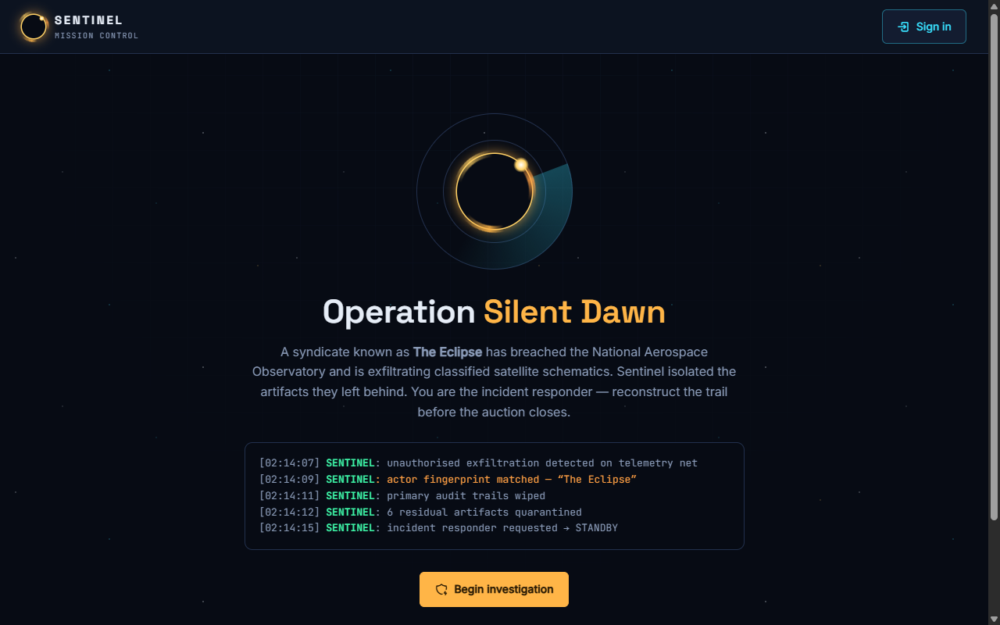<br><sub>Landing page</sub> | 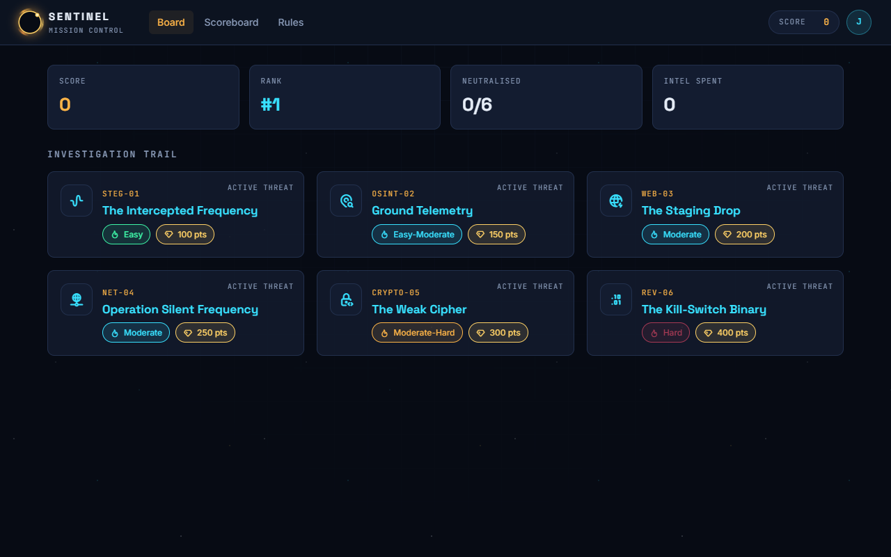<br><sub>Mission board</sub> |
| 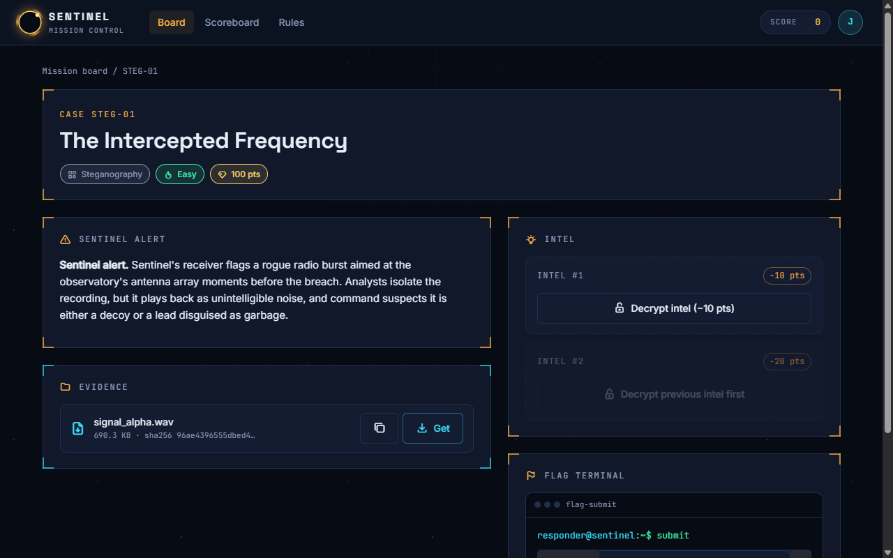<br><sub>Case file, intel and flag terminal</sub> | 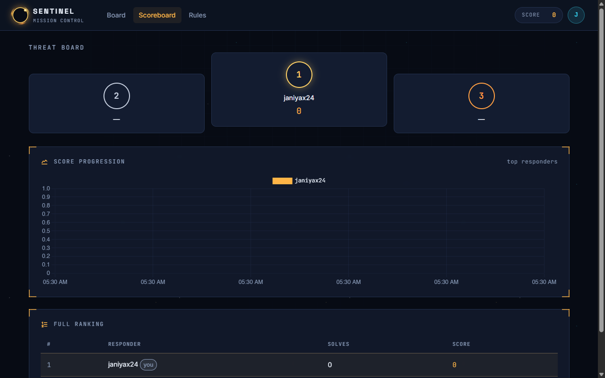<br><sub>Scoreboard</sub> |
| 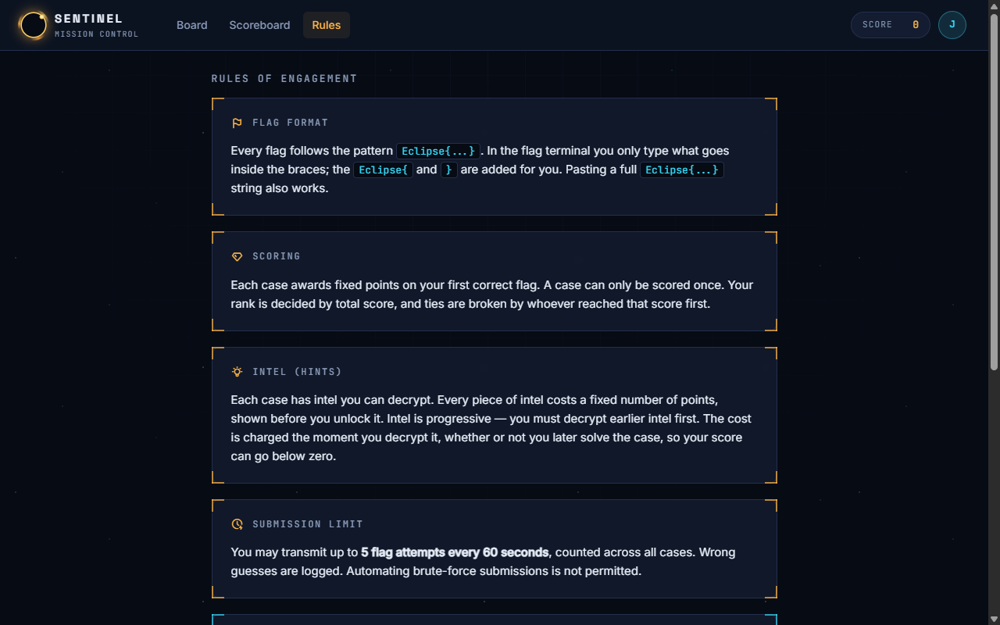<br><sub>Rules of engagement</sub> | 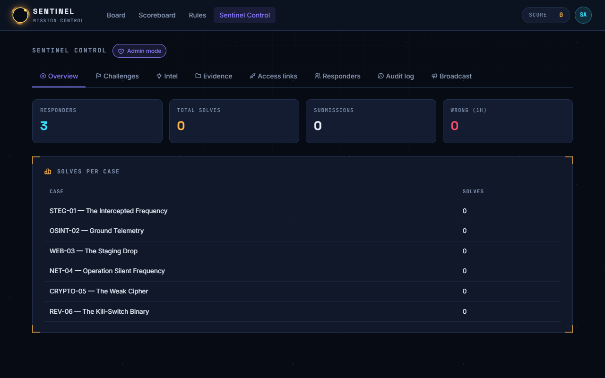<br><sub>Sentinel Control (admin)</sub> |

<picture><source media="(prefers-color-scheme: light)" srcset=".github/readme/assets/head-quickstart-light.svg"></picture>

You need a Supabase project and a Vercel account, both on free plans. The full walkthrough is in **[docs/SETUP.md](docs/SETUP.md)**. In short:

1. **Supabase:** run `supabase/schema.sql`, then `supabase/seed.sql`. Create a private bucket called `challenge-files`, and turn off public sign-up.
2. **Config:** put your project URL and anon key in `public/config.js`. Generate a flag pepper with `openssl rand -hex 32`.
3. **Vercel:** import the repo (no framework, no build step) and set these environment variables:

| Variable | Value |
|---|---|
| `SUPABASE_URL` | your project URL, e.g. `https://xxxx.supabase.co` (no `/rest/v1/`) |
| `SUPABASE_SERVICE_ROLE_KEY` | the service-role key (server only, never in the browser) |
| `FLAG_PEPPER` | the random hex string from step 2 |
| `CHALLENGE_BUCKET` | `challenge-files` |

4. **Admin:** create the first user in Supabase, promote it with SQL, then set each flag from **Sentinel Control → Challenges**.

To run it locally with the functions:

```bash
git clone https://github.com/janiyax35/sentinel-ctf.git
cd sentinel-ctf
npm i -g vercel
vercel link
vercel env pull .env.local
vercel dev
```

> The deploy steps are the ones the live instance was built with. Running locally with `vercel dev` hasn't been re-tested from a fresh clone yet.

<picture><source media="(prefers-color-scheme: light)" srcset=".github/readme/assets/head-security-light.svg"></picture>

This is a security course project, so the platform is built so that an attack on it is harder than the challenges themselves.

| Control | Where | Why |
|---|---|---|
| Flags stored only as HMAC-SHA256 with a server-side pepper | `api/_lib/util.js`, `challenge_flags` | A database leak doesn't reveal any answers |
| Timing-safe comparison (`crypto.timingSafeEqual`) | `api/submit.js` | No timing side channel on flag checks |
| Rate limit of 5 submissions per 60 s per responder | `api/submit.js` | Stops brute-forcing flags |
| Row-level security on every table, with no policies | `supabase/schema.sql` | The public anon key can't read or write any table |
| Service-role key and pepper only in Vercel env vars | `api/_lib/util.js` | Secrets never reach the browser |
| Every admin action re-checks the role on the server, with self-lockout and last-admin guards | `api/admin.js` | Hiding the UI isn't the control; an admin can't lock the platform out |
| Strict CSP with no inline scripts, `frame-ancestors 'none'`, `X-Frame-Options: DENY`, `nosniff` | `vercel.json` | XSS, clickjacking and MIME sniffing |
| Pinned CDN versions with Subresource Integrity | `public/*.html` | A tampered CDN file is refused by the browser |
| Briefings sanitised with DOMPurify; user text set with `textContent` | `public/assets/` | Stored XSS through case text or display names |
| Private bucket and 60-second signed URLs | `api/file.js` | Evidence can't be hotlinked or shared outside the event |
| Audit log keeps wrong guesses but never correct flags | `api/submit.js`, `submissions` | Cheating can be investigated without leaking answers |
| Public sign-up disabled; accounts created by the admin | Supabase Auth | Invite-only event |

<picture><source media="(prefers-color-scheme: light)" srcset=".github/readme/assets/head-contact-light.svg"></picture>

Built by **Janith Deshan**. The platform is invite-only: email me to be added to the access list. For questions or collaboration: [janithmihijaya123@gmail.com](mailto:janithmihijaya123@gmail.com) · [LinkedIn](https://linkedin.com/in/janithdeshan) · [janith.qzz.io](https://janith.qzz.io)

<a href="https://janith.qzz.io"></a>

<p align="center"><sub>Graphics generated by <code>.github/readme/build.mjs</code>. Part of the case files at <a href="https://janith.qzz.io/#cases">janith.qzz.io</a>. MIT licensed.</sub></p>
